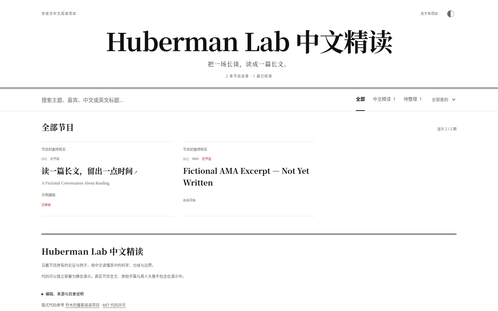

# Huberman Lab 中文精读

**中文** | [English](#english)

把 [Huberman Lab](https://www.hubermanlab.com/) 的节目内容整理成中文精读。目前站上已上线 350 篇中文精读。会持续更新。非官方项目。

界面示意，篇数以站点实时数据为准。

## 收录范围

收录范围不限于长访谈。完整节目、独立问答和其他有实质内容的节目均可评估；重复内容、推广与预告不制作。Essentials 须先与原节目去重，AMA 节选明确标注实际覆盖范围，不称为完整一期。制作仍要求可用的完整来源、独立全文审核和修订复验。

当前目录 412 条：长节目 321、Essentials 62、AMA 19、现场问答 10。已发布 350 篇：321 篇长节目、19 篇 AMA（3 篇公开全长、16 篇公开节选，不是会员版完整节目）、10 篇公开发行现场问答（非整场演讲）。其余 62 条 Essentials 保留在目录中：61 条确认是原节目重剪，不重复编写；1 条独立增量待核。目录数、官方 Feed 条目数与精读数不是同一口径。

## 访问地址

- 主站：https://huberman-reading-001.tolsonhuddy.chatgpt.site
- 备用站：https://tolsonhuddy-collab.github.io/huberman-tolson-cn/ （主站打不开时用备用站）

## 订阅 / RSS

- 全文 Feed（Atom）：https://tolsonhuddy-collab.github.io/huberman-tolson-cn/feed.xml
- Tolson-RSS（Huberman）：https://tolsonhuddy-collab.github.io/huberman-tolson-cn/podcasts/huberman/feed.xml
- 订阅清单 OPML：https://tolsonhuddy-collab.github.io/huberman-tolson-cn/tolson-rss.opml

### Obsidian 订阅

1. 打开 Obsidian 设置 → 第三方插件 → 浏览，搜索 RSS Dashboard（作者 amatya-aditya），安装并启用。
2. 从左侧边栏打开它，点「+」，粘贴 Feed 地址：https://tolsonhuddy-collab.github.io/huberman-tolson-cn/feed.xml
3. 必须把 Auto delete articles duration 设为 Disabled。默认 30 天会藏起全部文章，因为这些节目的发布日期更早。已经添加过的话，用 Adjust per-feed filter settings 修改。
4. 刷新后可以看到全文和卡片。

github.io 在中国大陆可能较慢，打不开时重试或换网络。手机版 Obsidian 步骤相同。

## 版权说明

非官方项目。转载请署名并链接对应原文页面。原节目音频与英文转写的版权归 Huberman Lab、嘉宾及制作方所有。详见 [CONTENT_RIGHTS.md](CONTENT_RIGHTS.md)。

版式改编自 [乔木的 lexfridman-cn](https://github.com/joeseesun/lexfridman-cn)，原声明在 [web/qiaomu-LICENSE.txt](web/qiaomu-LICENSE.txt)。

## 联系

taopatric58@gmail.com

小红书：Tolson 在叭叭（小红书号 9482664180），写给医疗圈的 AI 观察。

维护和构建说明见 [docs/开发说明.md](docs/开发说明.md)。

---

## English

A static Chinese reading companion to the [Huberman Lab](https://www.hubermanlab.com/) podcast. The public site has 350 published essays. Updated continuously. Unofficial.

## Coverage

Coverage is not limited to long interviews. Full episodes, standalone Q&As, and other substantive programmes are eligible; duplicate material, promotions, and trailers are excluded. Essentials must be checked against their original episodes. An AMA excerpt is labelled with its actual scope and is never presented as a full episode. Usable complete source material, independent full-text review, and revision checks remain required.

The catalog contains 412 records: 321 long episodes, 62 Essentials, 19 AMAs, and 10 live Q&As. The 350 published essays comprise 321 long episodes, 19 AMAs (3 publicly released full episodes and 16 public excerpts, not the complete member editions), and 10 released live Q&As, not entire event lectures. The remaining 62 Essentials stay in the catalog: 61 are verified recuts, and 1 has no confirmed independent increment. Catalog, official-feed, and essay counts have different meanings.

## Where to read

- Primary: https://huberman-reading-001.tolsonhuddy.chatgpt.site
- Backup: https://tolsonhuddy-collab.github.io/huberman-tolson-cn/ (use this if the primary site does not open)

## Subscribe / RSS

- Full-text Atom feed: https://tolsonhuddy-collab.github.io/huberman-tolson-cn/feed.xml
- Tolson-RSS (Huberman): https://tolsonhuddy-collab.github.io/huberman-tolson-cn/podcasts/huberman/feed.xml
- OPML list: https://tolsonhuddy-collab.github.io/huberman-tolson-cn/tolson-rss.opml

### Subscribe in Obsidian

1. Open Settings → Community plugins → Browse, search for RSS Dashboard (by amatya-aditya), install it, and enable it.
2. Open it from the left sidebar, click +, and paste the feed URL: https://tolsonhuddy-collab.github.io/huberman-tolson-cn/feed.xml
3. Set Auto delete articles duration to Disabled. This is required. The default of 30 days hides every essay, because the episodes are older than that. If the feed is already added, change it with Adjust per-feed filter settings.
4. Refresh to see the full text and the cards.

github.io may be slow in mainland China. If it does not load, retry or switch networks. Mobile Obsidian uses the same steps.

## Rights

Unofficial. If you republish an essay, attribute it and link to that episode page. Original audio and transcripts belong to Huberman Lab, the guests, and the producers. See [CONTENT_RIGHTS.md](CONTENT_RIGHTS.md).

The reading layout is adapted from [joeseesun/lexfridman-cn](https://github.com/joeseesun/lexfridman-cn).

## Contact

taopatric58@gmail.com

Xiaohongshu: Tolson 在叭叭 (9482664180).

Maintainer and build notes: [docs/DEVELOPMENT.md](docs/DEVELOPMENT.md).
